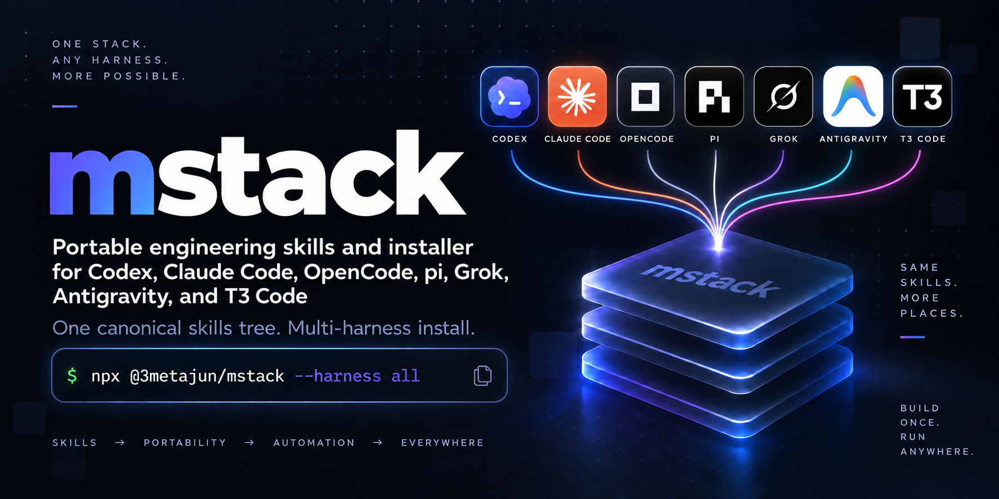

# mstack

[](https://github.com/3metaJun/mstack/actions/workflows/validate.yml)
[](https://www.npmjs.com/package/@3metajun/mstack)

Portable engineering skills for Codex, Claude Code, OpenCode, pi, Grok,
Antigravity, Cursor, and T3 Code. One canonical `skills/` tree feeds every
supported harness. The installer adapts harness metadata at install time, so
skill instructions stay free of vendor-specific paths and commands.



The bundle carries 61 skills: 57 adapted from
[`pstack`](https://github.com/cursor/plugins/tree/main/pstack/skills), three
from [`mattpocock/skills`](https://github.com/mattpocock/skills), and the local
`mstack-help` entry skill. Source revisions and licenses live in
[`THIRD_PARTY_NOTICES.md`](./THIRD_PARTY_NOTICES.md).

## Quick start

Node.js 18 or newer is required.

Install all 61 skills for every supported harness:

```bash
npx @3metajun/mstack --harness all
```

Or select specific harnesses and skills:

```bash
npx @3metajun/mstack --harness codex,claude
npx @3metajun/mstack --harness opencode,pi
npx @3metajun/mstack --harness antigravity,grok
npx @3metajun/mstack --harness all --skill writing-for-agents,codebase-design,diagnosing-bugs
```

Existing skill directories are preserved by default. Add `--dry-run` to preview
the plan. Add `--replace` to back up existing directories to a timestamped
`.harness-skills-backups/` folder outside the skill discovery root before
writing.

### Default install roots

Defined in [`profiles/harnesses.json`](./profiles/harnesses.json) and documented
in [Harness adapter reference](./docs/harness-adapters.md):

| Harness | Default user directory | Project directory (`--project`) | Override env var |
| --- | --- | --- | --- |
| Codex | `~/.agents/skills/` | `.agents/skills/` | `HARNESS_SKILLS_CODEX_DIR` |
| Claude Code | `~/.claude/skills/` | `.claude/skills/` | `HARNESS_SKILLS_CLAUDE_DIR` |
| OpenCode | `~/.agents/skills/` | `.agents/skills/` | `HARNESS_SKILLS_OPENCODE_DIR` |
| pi | `~/.agents/skills/` | `.agents/skills/` | `HARNESS_SKILLS_PI_DIR` |
| Grok | `~/.agents/skills/` | `.agents/skills/` | `HARNESS_SKILLS_GROK_DIR` |
| Antigravity (`agy`) | `~/.gemini/antigravity-cli/skills/` | `.agents/skills/` | `HARNESS_SKILLS_ANTIGRAVITY_DIR` |

- **Shared root:** Codex, OpenCode, pi, Grok, and Cursor all read
  `~/.agents/skills/`, so updating any of them refreshes the shared copy.
- **Claude Code:** Gets its own copy without frontmatter `name` (Claude names
  skills by directory; OpenCode 1 skips nameless copies, and OpenCode 2 prefers
  `~/.agents/skills/`).
- **Antigravity:** Keeps its own canonical copy under
  `~/.gemini/antigravity-cli/skills/` because it does not scan
  `~/.agents/skills/` at user scope.
- **T3 Code:** Lists the skills discovered by each provider you run in it and
  integrates natively with T3's delegation, PR watching, scheduling, and preview
  tools via host references. See [Use mstack in T3 Code](./docs/t3code.md).

## Install into a project

Use `--project` when a harness reads skills from the repository working
directory (including per-thread git worktrees in T3 Code):

```bash
npx @3metajun/mstack --harness codex,claude,pi --project /path/to/repo --dry-run
npx @3metajun/mstack --harness codex,claude,pi --project /path/to/repo
```

- Skills only: `--artifact`, `--migrate`, and `--environment` are refused with
  `--project`.
- Copies directly (never symlinks) and ignores `HARNESS_SKILLS_*_DIR` overrides.
- Refuses home directories, paths inside the mstack package, `.harness-skills-*`
  storage, or any discovery root (checked via physical paths).
- `--replace` backups land beside the skill roots under
  `<repo>/.agents/.harness-skills-backups/` and
  `<repo>/.claude/.harness-skills-backups/`. Add `.harness-skills-*` to
  `.gitignore`. Commit project skills if new worktrees need them.

## Claude Code, Claude Desktop, and T3 Code

### Claude Code plugin

This repository is also a Claude Code plugin marketplace shipping all 61 skills,
both agents (`mstack:meta-agent`, `mstack:comment-reviewer`), `tools/meta-mode/`,
and an opt-out `SessionStart` routing hook (`"sessionHook": false` in
`~/.config/mstack/models.json`; see
[Claude Code routing](./docs/guide/12-claude-code-routing.md)):

```bash
claude plugin marketplace add 3metaJun/mstack
claude plugin install mstack@mstack
```

Plugin skills are namespaced (for example `/mstack:meta-mode`). Pick either the
plugin or `npx @3metajun/mstack --harness claude` per machine; installing both
loads duplicate skills.

### Claude Desktop chat, Cowork, and claude.ai

Package upload-ready per-skill zip archives (rewriting cross-skill links to
plain text and validating upload frontmatter limits):

```bash
npm run pack-claude-skills -- --out dist/claude-skills
npm run pack-claude-skills -- --skill diagnosing-bugs,tdd --out dist/claude-skills
npm run pack-claude-skills -- --check
```

### T3 Code

[T3 Code](https://github.com/pingdotgg/t3code) surfaces the skills each provider
finds. Install mstack for your active providers, then restart the agent session.
When T3's MCP tools are present, `meta-mode`, `setup-mstack`, `recall`, and
`create-verification-skill` bind to T3's native `delegate_task`,
`watch_pull_request`, `schedule_task`, thread search, preview browser, and
device tools automatically via `references/hosts/t3code.md`. See
[Use mstack in T3 Code](./docs/t3code.md) for provider discovery roots, `$skill`
rewriting, worktree setup, and `overrides.t3code` model configuration.

## Optional artifacts

By default the installer writes skills only. Opt in to accompanying artifacts
with `--artifact` (or `--no-skills --artifact all`):

```bash
npx @3metajun/mstack --harness codex --artifact agents,meta-mode-tools
npx @3metajun/mstack --harness all --no-skills --artifact all
```

| Artifact | Default destination |
| --- | --- |
| `agents` | Codex: `$CODEX_HOME/agents/` (TOML); others: native `agents/` directory (Markdown) |
| `meta-mode-tools` | `tools/meta-mode/` beside the skill root (shared consumers: `~/.agents/tools/meta-mode/`) |
| `guide` | `docs/guide/` beside the skill root |
| `session-context` | `session-context/` beside the skill root (plain-text routing note, never implicit) |

Override per-harness destinations with `MSTACK_ARTIFACT_<ARTIFACT>_<HARNESS>_DIR`
or under `artifacts` in `~/.config/mstack/environments.json`. The optional
Cursor automation pack under `automations/benny/` is excluded from cross-harness
installs; review and copy it into `.cursor/automations/benny/` directly.

## Migration, custom targets, and SSH

Migrate legacy OpenCode/pi installs and older backup trees out of discovery
roots:

```bash
npx @3metajun/mstack --harness all --migrate --replace --dry-run
npx @3metajun/mstack --harness all --migrate --replace
```

Migration verifies mstack ownership via install receipts or released `SKILL.md`
digests, stops before writes on unrecognized same-name copies, and rolls back on
failure.

For named local, mounted, or POSIX SSH environments (`ssh` + `rsync`), copy
[`profiles/environments.example.json`](./profiles/environments.example.json) to
`~/.config/mstack/environments.json` (or set `MSTACK_ENVIRONMENTS_FILE`) and
pass `--environment <name>`:

```bash
npx @3metajun/mstack --harness opencode --environment fleet-ssh --dry-run
npx @3metajun/mstack --harness opencode --environment fleet-ssh
```

Remote installs stage locally, transfer with `rsync`, acquire a timestamped
remote lock (`<target-parent>/.mstack.install.lock/owner`), and swap atomically.
For custom remote Codex layouts, set `artifacts.agents.codex` explicitly.

## Model configuration and `run-role`

Per-role model choices live in `~/.config/mstack/models.json` (see
[`profiles/models.example.json`](./profiles/models.example.json)). Run
`/setup-mstack` to configure models and reasoning budgets (`unlimited`, `large`,
`medium`, `small`) or validate the file directly:

```bash
npm run check-models -- --file ~/.config/mstack/models.json
```

- Roles (`implementer`, `reviewer`, `judge`, `explorer`, `synthesizer`,
  `candidate`, `operator`) default to `inherit-parent`.
- `reviewer` accepts a single model string or a non-empty list of unique models
  (used by `/interrogate` and `--all-models` fanout).
- T3 Code uses `overrides.t3code` with `{ "provider", "model", "effort" }` or
  `"<provider>/<model> (<effort>)"` entries; `run-role` rejects `t3code` as a
  harness.

Execute or dry-run a configured role from the CLI:

```bash
npm run run-role -- --harness opencode --role explorer \
  --prompt "Inspect the repository and do not edit files" \
  --environment fleet-ssh --model auto

npm run run-role -- --harness codex --role reviewer \
  --file ~/.config/mstack/models.json --prompt "Review this diff" \
  --all-models --read-only --execute
```

`inherit-parent` requires `--parent-model <name>` for new CLI processes; `auto`
uses the CLI default. `--all-models` requires `--read-only`.

## Included skills

The 61 skills cover:

- **Orchestration (`meta-mode`):** 22 playbooks (investigation, bug fix, perf,
  hillclimb, runtime/trace forensics, feature, refactoring, prototype, visual
  parity, skill authoring, eval, babysit, shipping, autonomous run,
  autopilot-full, autopilot-stack, session pickup, pause safely, multi-phase
  plan, worktree cleanup, opening a PR) plus `worker.md` for spawned agents.
- **24 engineering principles (`principle-*`):** Domain modelling, boundaries,
  type discipline, idempotence, verification, sequencing, root-cause fixes,
  context guarding, and structural encoding.
- **Understanding and design:** `how`, `why`, `teach`, `recall`, `ketchup`,
  `ketchup-video`, `in-your-own-words`, `sharpen`, `architect`, `arena`,
  `swarm`, `blast-radius`, `codebase-design`, `figure-it-out`,
  `show-me-your-work`.
- **Quality and verification:** `diagnosing-bugs`, `tdd`, `interrogate`,
  `benchmark-checklist`, `statechart`, `create-verification-skill`,
  `maintain-verification-skill`, `create-formal-verification-skill`,
  `maintain-formal-verification-skill`, `typescript-best-practices`,
  `no-comments`, `unslop`, `technical-writing`, `writing-for-agents`.
- **Customization and setup:** `setup-mstack`, `mstack-help`, `automate-me`,
  `reflect`, `correct`, `bro`, `make-bot-ui`.

### Session history recovery and project playbooks

- `recall` ships `skills/recall/scripts/history.mjs` to list and search scoped
  Codex, Claude Code, OpenCode (`--local-text` for unsanitized local recovery),
  and pi transcripts without repository scripts. See
  [history sources](./skills/recall/references/history-sources.md).
- Validate repository playbook extensions in `.agents/playbooks/` with:
  ```bash
  node tools/meta-mode/check-playbooks.mjs <project-root>
  ```
- Initialize mixed `pstack`/`mstack` project verification contracts with
  `mstack-policy` (see [mixed-Harness adoption](./docs/guide/11-mixed-harness.md)):
  ```bash
  npx --package @3metajun/mstack mstack-policy init --root <project> --app web --check 'node --test' --pstack <exact-pstack-commit>
  ```

## Smoke test and reviewed harness versions

Check installed skills and CLI availability (add `--execute` for read-only live
probes; note OpenCode `plan` and Antigravity `--mode plan` are agent modes, not
strict tool allowlists):

```bash
npm run smoke-harnesses -- --harness all --require-installed
```

| Harness | Reviewed stable (2026-11-12) | Verification |
| --- | --- | --- |
| Codex CLI | [0.167.2](https://github.com/openai/codex/releases/tag/rust-v0.167.2) | npm metadata and release, `exec --help` from the npm package |
| Claude Code | [2.1.322](https://github.com/anthropics/claude-code/blob/main/CHANGELOG.md) | npm metadata, local version, `--help` |
| OpenCode 2 | [2.2.7](https://github.com/anomalyco/opencode/releases/tag/v2.2.7) | npm metadata, local version, `run --help`, live `run --agent plan`, `recall` list/read, `api skill.list` |
| OpenCode 1 | [1.19.5](https://github.com/anomalyco/opencode/releases/tag/v1.19.5) | npm metadata and release, live `run --agent plan`, `recall` list/read from the npm package |
| pi | [1.5.2](https://github.com/earendil-works/pi/releases/tag/v1.5.2) | `@earendil-works/pi-coding-agent` metadata and release, `--help` |
| Antigravity | [1.5.6](https://antigravity-cli-auto-updater-974169037036.us-central1.run.app/manifests/windows_amd64.json) | Official manifest, binary SHA512, downloaded binary version, `--help` |
| Grok Build | 1.0.77 | `grok update --check --json`; `--help` from local 1.0.70 |

OpenCode 2 (`@opencode/cli`) removed `run --pure`, so `profiles/harnesses.json`
runs `opencode run` without it (leaving OpenCode 1 external plugins enabled) and
`recall` selects OpenCode 1 vs 2 commands by major version. The `opencode-ai`
package remains on the 1.19 line, so both majors are supported. See
[Harness adapter reference](./docs/harness-adapters.md) for versioned discovery
details.

## Repository layout and maintenance

- `skills/` canonical, harness-neutral skill files (`profiles/skills.json` inventory)
- `adapters/` per-harness frontmatter rules
- `profiles/` harness roots, artifacts, model templates, upstream pins (`upstreams.json`, `upstream-manifest.json`, `skill-manifest.json`)
- `agents/` portable `meta-agent` and `comment-reviewer` definitions
- `hooks/` Claude Code plugin `SessionStart` hook (`scripts/session-hook.mjs`)
- `tools/meta-mode/` optional Bun PR watcher (`watch-pr/`), `check-playbooks.mjs`, `worktree-audit.mjs`, `resume.mjs`, and `pr-safety.mjs`
- `docs/` workflow guide (`docs/guide/`), T3 Code guide (`docs/t3code.md`), adapter reference (`docs/harness-adapters.md`), and baseline review guide (`docs/skill-integrity.md`)
- `.claude-plugin/` and `.codex-plugin/` plugin manifests

### Verify and sync upstreams

```bash
npm test
npm run check-package
npm run check-upstream -- --source /path/to/pstack --strict
npm run skill-baseline -- --check --source /path/to/pstack --matt-source /path/to/mattpocock-skills
npm run sync-upstream -- --source /path/to/pstack        # dry-run; add --apply [--force] to write
npm run upstream-drift                                   # list new upstream commits past pinned refs
```

See [Reviewing skill baselines](./docs/skill-integrity.md) before refreshing
`profiles/skill-manifest.json` with `--write`.

## License

MIT. Upstream source revisions and licenses are recorded in
[`THIRD_PARTY_NOTICES.md`](./THIRD_PARTY_NOTICES.md).
